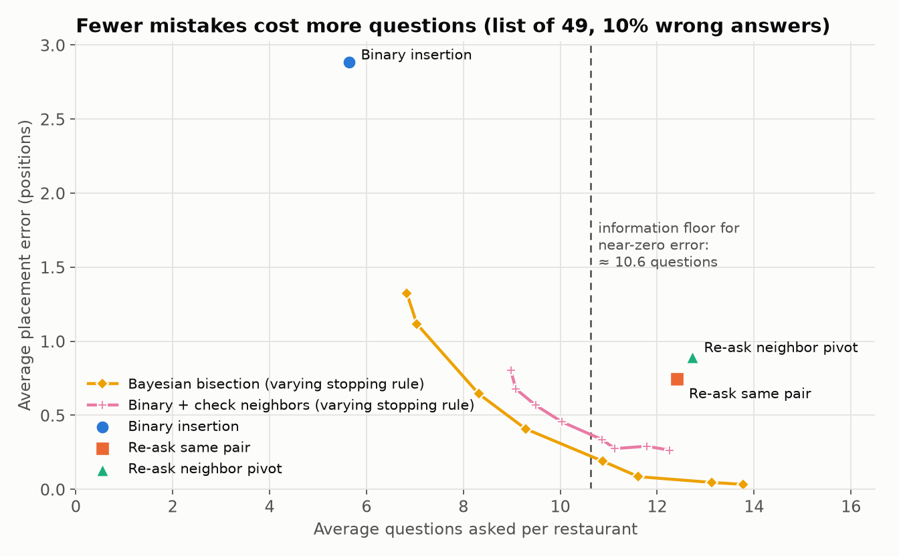

# PairRank

[](https://github.com/winxonn44/pair-rank/actions/workflows/ci.yml)

> **A note on inspiration.** PairRank was inspired by Beli,
> the restaurant-ranking app, which asks "better or worse?" instead of asking for
> star ratings. This project is not a copy of Beli and doesn't try to reproduce
> its algorithms, scores or design. It's an independent, experimental study of
> how ranking-by-comparison algorithms for personal taste behave when people
> answer inconsistently. It isn't affiliated with Beli and uses no Beli data.

How few "better or worse?" questions does it take to place a new restaurant in
someone's ranked list when people answer inconsistently, and what does that do
to the 0–10 scores they see?

PairRank is a simulation study plus a small app in Django, PostgreSQL and
Angular. Every experiment uses simulated users with known true preferences, so
placement error can be measured exactly. The A/B test runs both offline and end
to end through the app on one machine. No data is collected from people.

**Status:** simulation results for Q1, Q2 and Q4 are in, and the app's Postgres schema is
built; its API and Angular front end come next. Simulated users, constant noise, 10% wrong answers, list of 49:

- **Placement.** Binary insertion misplaces the 50th restaurant by 2.88 positions in 5.6
  questions; Bayesian bisection reaches 0.20 positions in 10.9. The gain shrinks when
  mistakes concentrate on close pairs or repeat themselves.
- **Score drift.** A restaurant's 0–10 score moves about 0.94 points as a list grows from
  10 to 50, even with perfectly consistent answers, matching the drift law to 2.3%.
- **A/B test.** 481 users per arm detect a 0.25-position improvement at 80% power, checked
  by 2,000 simulated experiments (A/A false-positive rate 4.35%).

Hypotheses that failed are kept in [`docs/RESULTS.md`](docs/RESULTS.md).



## Setup

```bash
python3 -m venv .venv
.venv/bin/pip install -e ".[dev]"
.venv/bin/pytest
.venv/bin/python scripts/s0_oracle_check.py   # simulator vs exact oracle
.venv/bin/python scripts/q1_placement.py      # Q1 grid, about 5 min on 8 cores
.venv/bin/python scripts/q2_drift.py          # Q2, about 30 s
.venv/bin/python scripts/q4_abtest.py         # Q4, about 3 min
.venv/bin/python scripts/make_figures.py      # every figure and table
```

The app needs Docker for PostgreSQL 17 (bound to localhost only):

```bash
.venv/bin/pip install -e ".[dev,backend]"
docker compose up -d --wait
cd backend
DEBUG=1 ../.venv/bin/python manage.py migrate
DEBUG=1 ../.venv/bin/python manage.py loaddata la_places
../.venv/bin/pytest
```

## Design notes

- [`docs/DECISIONS.md`](docs/DECISIONS.md): every design decision, with the reason and what was measured.
