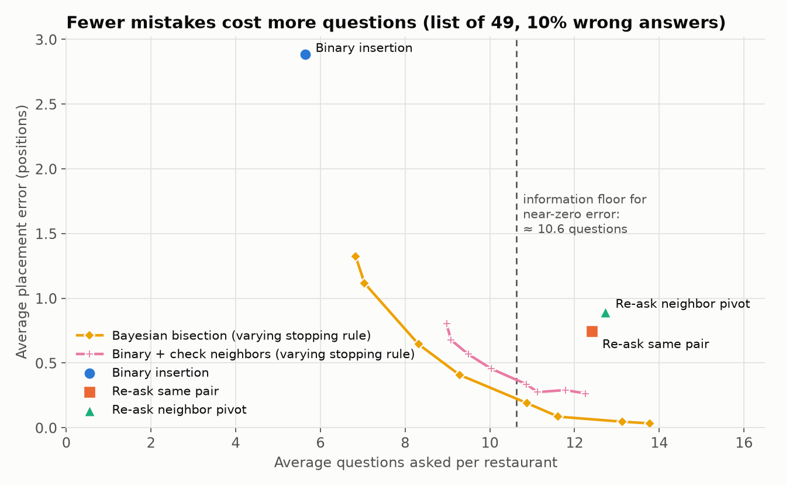
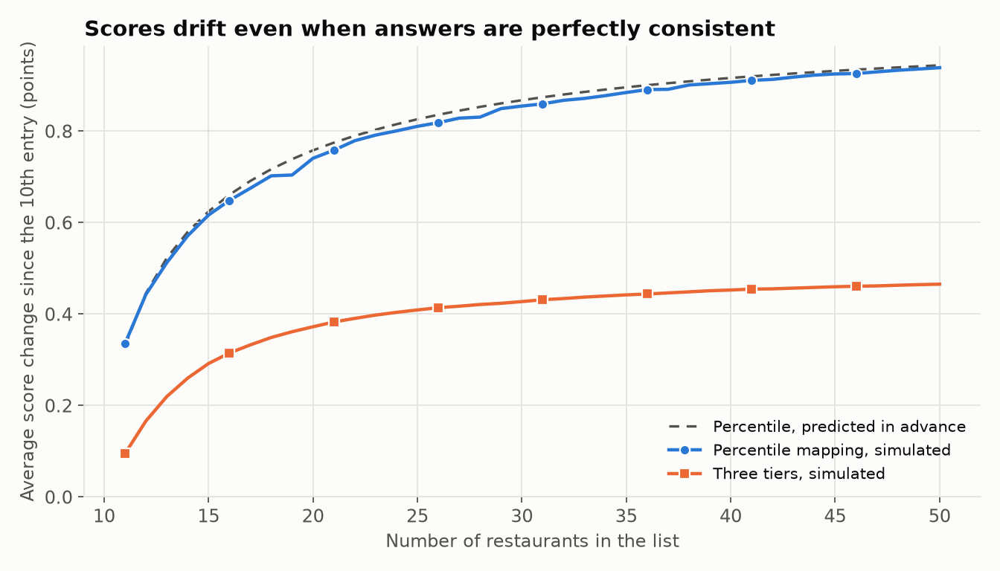
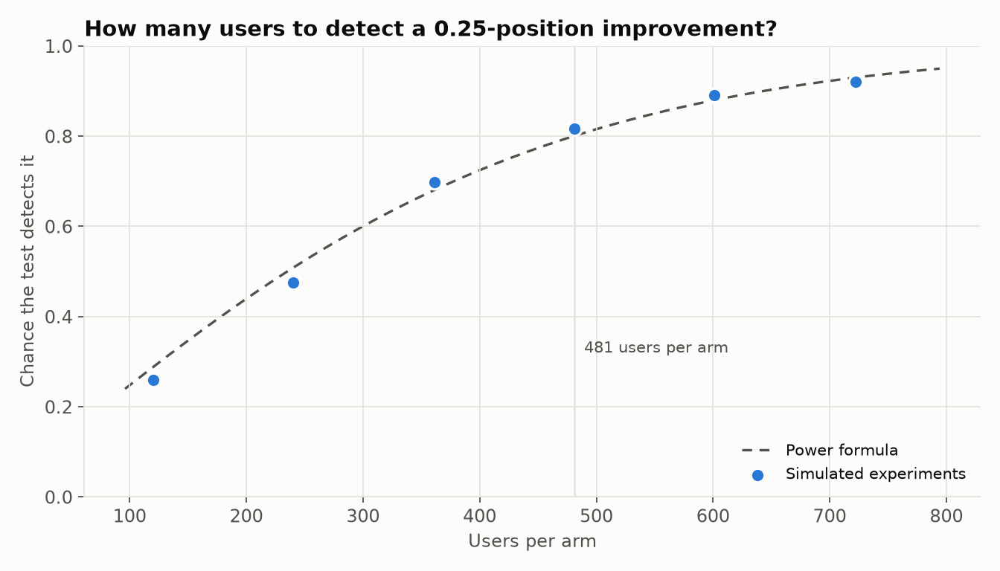

# PairRank: results log

Measured numbers only. Each section names the script that produced it and the
JSONL file it wrote. Hypotheses that fail stay in the log.

## S0: the simulator agrees with an exact oracle (2026-11-06)

**Question.** Before any strategy comparison means anything, the simulator has
to be right. For binary insertion under constant noise (each answer wrong with
probability ε, independently), the exact distribution of where a restaurant
ends up can be computed without sampling: `oracle.enumerate_binary_insertion`
walks every branch of the search. The simulation (`sim/session.py` driving
`strategies/binary.py`) must reproduce it.

**Command.** `python scripts/s0_oracle_check.py` → `runs/s0_oracle.jsonl`
(10,000 insertions per cell, master seed 20261106, about 2 s on an M4 MacBook
Air). Rerun on the clean commit `a68d741`, with identical numbers.

**Result: all 16 cells pass.** The largest gap between simulated and exact mean
error is 1.28 standard errors (pass: < 3), and the smallest χ² p-value for the
full error distribution is 0.094 (pass: > 0.001).

Mean |rank error| in positions (exact = the oracle; first order = ε(n + 1)/2):

| n | ε = 0.05 exact / sim | ε = 0.10 exact / sim | ε = 0.20 exact / sim | ε = 0.30 exact / sim | first order at ε = 0.10 |
|---|---|---|---|---|---|
| 9 | 0.321 / 0.311 | 0.643 / 0.658 | 1.292 / 1.287 | 1.948 / 1.968 | 0.50 |
| 19 | 0.603 / 0.605 | 1.222 / 1.219 | 2.503 / 2.546 | 3.836 / 3.858 | 1.00 |
| 49 | 1.412 / 1.426 | **2.890** / 2.933 | 6.029 / 6.071 | 9.383 / 9.437 | 2.50 |
| 99 | 2.740 / 2.644 | 5.645 / 5.685 | 11.894 / 11.802 | 18.643 / 18.677 | 5.00 |

At ε = 0.10, binary insertion places the restaurant exactly right only part of
the time, using fewer than ⌈log₂(n + 1)⌉ questions on average:

| n | exactly placed (sim) | mean questions (sim) |
|---|---|---|
| 9 | 69.4% | 3.36 |
| 19 | 62.8% | 4.35 |
| 49 | 55.3% | 5.65 |
| 99 | 49.6% | 6.63 |

**What this says.**
- The simulator is trustworthy for binary insertion under constant noise. Every
  later strategy is checked against an exact result in the same way (S1:
  posteriors against `oracle.exact_slot_posterior`).
- The first-order law ε(n + 1)/2 underestimates the exact error by 13–29% at
  ε = 0.10 (2.50 vs 2.89 at n = 49), and by more at higher ε (7.50 vs 9.38 at
  n = 49, ε = 0.30). Small intervals late in the search and stacked mistakes
  aren't in the first-order argument. **The exact value, 2.89 positions for the
  50th restaurant at 10% noise, is the baseline every other strategy is compared
  with in S1.**
- Even at 10% noise, binary insertion misplaces the 50th restaurant almost half
  the time (55.3% exact placement).

**Other S0 checks** (all in `pytest`, 100 tests, about 2.5 s):
- Two independent oracles (branch walk, and a loop over every right/wrong
  answer pattern) agree to 1e-15.
- With no noise, binary insertion is exact for n ∈ {0, 1, 2, 3, 7, 8, 49, 100},
  1,000 random insertions each, within ⌈log₂(n + 1)⌉ questions.
- The strategy state round-trips through JSON at every step of 200 random
  insertions.
- Bradley–Terry noise calibrated to ε ∈ {0.05, 0.1, 0.2, 0.3} gives an
  empirical error rate within ±0.002 of the target on 10⁶ fresh pairs.
- `kendall_tau_bruteforce` matches SciPy on 1,000 random permutations.

## Q1: how many questions are worth asking? (2026-11-09, checkpoint S1)

**Command.** `python scripts/q1_placement.py` → `runs/q1.jsonl` (426 configurations,
10,000 insertions per cell or 1,000 whole lists, master seed 20261109, 302 s on 8
worker processes, M4 MacBook Air on AC power). `python scripts/make_figures.py`
regenerates the figures and `docs/tables/`. The rows record commit `956843c` with
no uncommitted changes. A rerun at that commit reproduced every row apart from timestamps.

**Strategies.** `binary` (S1); `majority` (S2, ask twice, a third time on conflict);
`majority-neighbor` (S2b, re-asks use an adjacent pivot); `bisection` (S3a, posterior
over slots, stop at 90% confidence or 4⌈log₂(n + 1)⌉ questions); `verify` (S4, binary,
then check both neighbors, then bisection if either contradicts). S3b, Bradley–Terry
active querying, moved to S1b.

### The headline cell: the 50th restaurant, list of 49, 10% wrong answers

Average placement error in positions (± 95% CI), and average questions:

| Strategy | Constant noise | Questions | Close pairs noisier (BT) | Questions | Sticky errors (BT, ρ = 0.7) | Questions |
|---|---|---|---|---|---|---|
| Binary insertion | **2.88** ± 0.11 | 5.64 | 3.57 | 5.61 | 3.57 | 5.60 |
| Re-ask same pair | 0.75 ± 0.06 | 12.41 | 2.42 | 13.05 | 3.44 | 11.71 |
| Re-ask neighbor pivot | 0.90 ± 0.06 | 12.72 | 2.43 | 13.02 | 2.55 | 13.14 |
| **Bayesian bisection** | **0.20** ± 0.03 | **10.88** | 1.93 | 14.78 | 2.78 | 9.82 |
| Binary + check neighbors | 0.37 ± 0.04 | 10.84 | 2.03 | 14.65 | 3.31 | 8.84 |

**What this says.**
- Under constant noise, asking about twice as many questions (5.6 → 10.9) cuts the
  error about 14× (2.88 → 0.20), right at the information floor of about 10.6
  questions for near-zero error.
- **How much extra questions help depends heavily on how people are wrong.** When
  mistakes concentrate on close pairs, the same strategy only halves the error (3.57 →
  1.93), and it needs 14.8 questions. When a user repeats the same wrong answer about
  a pair, re-asking that pair is nearly worthless.
- Bayesian bisection has the lowest error in the constant and BT columns.
  **"Check neighbors, then investigate" isn't better than plain bisection**: at the
  same question count it has about 1.9× the error under constant noise.

### Hypotheses

| # | Hypothesis | Expected | Result | Verdict |
|---|---|---|---|---|
| H1 | Binary's error grows about linearly in n and ε; the first-order law runs low, by less as n grows | 2.89 at n = 49, ε = 0.1 | Simulated 2.883, exact 2.890. Exact/first-order ratio falls with n at every ε (ε = 0.1: 1.29, 1.22, 1.16, 1.13) | **Kept** |
| H2 | At the same average ε, BT noise gives binary ≥ 2× less error than constant noise | ≥ 2× smaller | **The opposite**: BT error is 1.06–1.32× *larger* (3.57 vs 2.88 at ε = 0.1) | **Rejected** |
| H3 | `verify` cuts error ≥ 50% for ≤ 3 extra questions (n = 49, ε = 0.1, constant) | ≥ 50% at ≤ 3 | 87% lower, but **5.20 extra questions** (rejection line was > 4) | **Rejected on cost** |
| H4 | Bisection reaches majority's accuracy with ≥ 20% fewer questions | ≥ 20% | 35% fewer at ε = 0.1 constant; 27–39% across all six noise cells (interpolated on the stopping-rule sweep) | **Kept** |
| H5 | Bradley–Terry active querying wins only under BT noise | | Moved to S1b | Deferred |
| H6 | Same-pair re-asking collapses under sticky errors; neighbor pivots hold up | Loses ≥ 50% of its advantage; neighbor loses < 20% | At ρ = 0.7 same-pair keeps 8% of its advantage over binary (loses 92%); neighbor pivot loses 16% | **Kept** |

**Why H2 failed.** The hypothesis reasoned correctly about *where* BT errors happen
but matched the noise levels the wrong way. T is calibrated so random pairs are wrong
10% of the time, but a search deliberately asks about close pairs, so users are wrong
on **22%** of the questions actually asked (`realized_error_rate`), against 10% for
constant noise. Exploratory, not pre-registered: comparing at equal *realized* error
rates (interpolating the constant-noise cells), BT gives about 1.9–2.6× less error,
which is what the mechanism predicted. The lesson for a real product: an error rate
measured on random pairs understates the error rate during ranking.

**Why H3 failed.** The neighbor checks raise a contradiction on 51% of insertions at
ε = 0.1, well above what a "check only when uncertain" strategy should trigger: each
of two extra answers can itself be wrong. Once triggered, investigating is expensive.
Accuracy beat the target and cost missed it.

### What else the run showed

- **Whole lists are much worse than the single-insertion math suggests.** Building a
  50-entry list with binary insertion at ε = 0.1 gives Kendall's τ = **0.736**. The
  design doc predicted about 0.90 to first order, and summing the exact insertion
  errors on an always-correct list gives 0.877. The remaining gap is compounding:
  later restaurants are compared against a list that already has mistakes, which
  roughly doubles the disorder (1 − τ goes from 0.12 to 0.26). Over a list of 50,
  bisection reaches τ = 0.968 for 420 questions against binary's 214.

  | τ, list of 50, ε = 0.1 | Binary | Re-ask same | Re-ask neighbor | Bisection | Check neighbors |
  |---|---|---|---|---|---|
  | Constant | 0.736 | 0.919 | 0.901 | **0.968** | 0.964 |
  | BT | 0.799 | 0.868 | 0.867 | **0.899** | 0.895 |
  | Sticky | 0.796 | 0.801 | **0.850** | 0.834 | 0.816 |

- **One extra question can do a lot, under constant noise** (exploratory). Bisection
  with a loose stopping rule (δ = 0.5) cuts the error from 2.88 to 1.32 for 1.2 extra
  questions. Under BT noise the same setting gives 3.57 → 2.82 for 1.4 extra questions.
- **Accuracy after each question.** See `figures/q1_error_per_question.png`. Binary
  stops improving at about 6 questions (2.7 positions); bisection is at 2.0 after 6,
  1.3 after 8 and 0.5 after 12.
- **Wrong first answer** (stress test, n = 49): binary misplaces by 13.0 positions
  (first-order estimate (n + 1)/4 = 12.5), never placing exactly. `verify` detects it
  in 100% of insertions and bisection recovers it fully.
- **The cost of a wrong assumption.** Bisection and `verify` assume ε̂ = 0.10. With
  ε = 0.30 and constant noise bisection's error is 5.2 at 15.1 questions, against
  binary's 9.3. It still helps, but budget and confidence don't scale with the real noise.

### A bug the oracle tests caught

The first version of bisection asked at the first position past half the probability.
On a posterior like [0.47, 0.47, 0.06], that rule keeps asking the same position and
can't separate the first two slots, so it placed restaurants wrongly **with no noise at
all**, for n = 2, 3, 7 and 8. The ε = 0 exactness test failed; asking at the position
whose split is closest to 50/50 fixed it. The test stays as a permanent guard.

### Limits

These are simulated users. The conclusions that depend on the noise model are labeled
above, and nothing here is a fact about real people or about Beli.

## Q2: how much do 0–10 scores move? (2026-11-09, checkpoint S2)

**Command.** `python scripts/q2_drift.py` → `runs/q2.jsonl` (2,000 simulated users per
cell, master seed 20261110, 26 s, M4 on AC power). Recorded at commit `956843c`, clean,
and reproduced exactly by a rerun.

**The drift law holds.** With perfectly consistent users, a place at true quantile q moves
by a standard deviation of 10√(q(1 − q)(1/a − 1/b)) between lists of a + 1 and b + 1
entries. All nine (q, a, b) cells came within **2.3%** of that (pass: ±10%). Adding one
restaurant also changes every other score by exactly the closed form, to 1e-12, for every
slot and list size up to 100.

| Mapping | Strategy | ε | Drift, 10th → 50th entry (points) | Displayed scores changed by the 50th restaurant | Error vs true score at 50 (points) |
|---|---|---|---|---|---|
| Percentile | any (no noise) | 0 | **0.94** ± 0.02 (predicted 0.94) | 60% | 0.44 |
| Three tiers | any (no noise) | 0 | 0.47 ± 0.01 | 19% | 0.25 |
| Percentile | Binary | 0.1 | 0.98 | 60% | 1.16 |
| Percentile | Bisection | 0.1 | 0.95 | 60% | 0.53 |
| Three tiers | Binary | 0.1 | 0.48 | 19% | 0.44 |
| Three tiers | Bisection | 0.1 | 0.48 | 19% | 0.28 |

**What this says.**
- **A restaurant's score moves about one point just because the list grew from 10 to 50**,
  with no change of opinion and no wrong answers. Answer noise barely adds to that.
- **Adding one restaurant visibly changes about 60% of the others' displayed scores**
  (at one decimal). The design doc's rough estimate was 67%; averaging the exact per-entry
  change with a cap at 100% predicts 58.5%, close to the measured 60%.
- Better placement improves accuracy against the true score (1.16 → 0.53), but it doesn't
  reduce drift. Drift comes from the list growing, not from mistakes.
- **Three tiers roughly halve drift and cut visible changes to 19%.** The accuracy gain in
  that row is not free: the simulation assumes every user picks the right tier, which is
  extra, correct information. A real user picks the tier with some noise, not modeled here.

| # | Hypothesis | Expected | Result | Verdict |
|---|---|---|---|---|
| H7 | Tiers cut drift to about 0.58× percentile | 0.58× ± 0.05; rejected outside [0.50, 0.66] | **0.496×** (0.465 / 0.938), so slightly better than predicted but outside the band | **Rejected, narrowly** |

The 0.58× estimate only accounted for the narrower band and the smaller per-tier sample.
The likely remainder is the mid-rank formula, which pulls scores toward the band center
when a tier has few entries. That explanation wasn't tested separately.

## Q4: an A/B test with a checked power analysis (2026-11-09, checkpoint S3)

**Command.** `python scripts/q4_abtest.py` → `runs/q4.jsonl` (50,000 simulated users per
arm; 2,000 simulated experiments per check, except the power curves at 1,000; master
seed 20261111; 158 s, M4 on AC power). Recorded at commit `956843c`, clean, and
reproduced exactly by a rerun.

**Setup.** Each user has 29 places already ranked and adds 20 more in a session, at 10%
wrong answers (constant noise). Metric: the user's mean placement error, which only a
simulation can see. Test: two-sided Welch t-test at α = 0.05.

| Arm | Mean error per user | SD across users | Questions per insertion | Audit disagreement |
|---|---|---|---|---|
| Binary (control) | 3.02 ± 0.01 | 1.42 | 5.30 | 14.3% |
| Bayesian bisection | 0.22 ± 0.003 | 0.36 | 10.27 | 10.3% |
| Binary + check neighbors | 0.39 ± 0.005 | 0.58 | 10.22 | 10.6% |

**Validity checks: all pass.**

| Check | Result | Band set in advance |
|---|---|---|
| A/A false-positive rate (n = 509 per arm) | **4.35%** | [4.0%, 6.0%] |
| Peeking at 5 looks, no correction | **14.9%** | [12.7%, 15.7%] |
| Peeking with Pocock's threshold (0.0158) | 4.95% | [4.0%, 6.0%] |
| Empirical power, 6 scenarios | **78.6%–81.4%** | [78.2%, 81.8%] |

**Sample size.** The full swap to bisection is a 2.8-position effect, which a handful of
users would reveal, so that isn't the interesting question. A real experiment hunts for
small effects, so the power check scales the effect down: each insertion goes through the
treatment with probability f, which gives an average effect of f × 2.8 positions.

| Improvement to detect | Users per arm (bisection) | Simulated power | Users per arm (`verify`) | Simulated power |
|---|---|---|---|---|
| **0.25 positions** | **481** | 79.1% | 485 | 81.4% |
| 0.50 positions | 115 | 79.9% | 114 | 80.3% |
| 1.00 position | 26 | 78.6% | 26 | 79.6% |

**Guardrail: more questions, more quitting.** Questions per insertion nearly double. If
each question carried a chance h of the user abandoning the insertion (an assumption,
not data), completion would be:

| h per question | Binary | Bisection |
|---|---|---|
| 0.5% | 97.4% | 95.0% |
| 1% | 94.8% | 90.3% |
| 2% | 89.9% | 81.5% |

| # | Hypothesis | Expected | Result | Verdict |
|---|---|---|---|---|
| H10 | A user's audit disagreement tracks their true error | correlation ≥ 0.5; rejected below 0.3 | **r = 0.22** with one audit question per user, among users with varied error rates | **Rejected** |

**Why that matters.** A single audit answer is far too noisy to measure one user, so a real
product couldn't validate individual users with it. Exploratory: r rises to 0.44 with 5
audits and 0.68 with 20. At the arm level it does separate the groups (14.3% vs 10.3%), and
its floor is the 10% users get wrong on any question, so it's more useful for comparing
arms than judging individuals. The arm-level result is the part a real experiment could use.

**Limits.** Users here are independent. In a social app friends see each other's lists,
which interferes with randomization, so a real test would randomize by friend cluster. The
drop-off model is an assumption, and the primary metric isn't observable in production.

## A2: the app runs the evaluated code

Regenerate with `cd backend && ../.venv/bin/pytest ranking/tests/test_replay.py` (about 1 minute,
needs Postgres).

- **1,080 of 1,080 simulated transcripts replayed through the API matched the simulator**: same
  question at every step, same final position, same question count, same logged comparison rows.
  Five strategies × ε ∈ {0, 0.1, 0.2} × n ∈ {0, 1, 2, 7, 20, 50} × 12 transcripts.
- Five whole sessions (one per strategy, 30 places, ε = 0.15), where each insertion depends on
  earlier mistakes, built the same list in the same number of questions as `build_list`.
- Two tabs racing to finish on one list, 25 rounds: exactly one 200 and one `list_changed` 409
  every round. A double-click from two connections, 25 rounds: one answer written, both get the
  same response.
- The tests were checked by breaking the code on purpose. Removing the row lock failed the race
  tests, flipping better/worse or adding an off-by-one to the final slot failed the replay, and
  removing `select_related` failed the query bounds.

Limit: this shows the HTTP layer adds no error of its own. It says nothing about how real people
answer, which no result in this project measures.

## S4: SQL metrics on simulated sessions

Regenerate with `.venv/bin/python scripts/load_sim_to_pg.py` (about 15 s, needs Postgres). Data:
500 simulated users per strategy, each attempting 20 insertions into a list starting at 29, with
10% constant noise and a 1% chance of quitting at each question. That loads 50,000 insertions and
461,806 comparison rows into the app's schema.

**Pass: all 8 queries in `sql/sim_metrics.sql` equal independent pandas versions**, exactly for
counts and to 1e-9 for means. The largest difference anywhere was 6e-14. pandas works from the
rows generated in memory, so a lost row would show as a mismatch. Planting four bugs in the SQL
(integer division, an off-by-one in the contradiction rule, including abandoned rows, a wrong
denominator) failed the matching test each time. All 2,500 lists were contiguous at the right version.

| Strategy | Mean error | Exact | Questions (completed) | Contradicted | Completed |
|---|---|---|---|---|---|
| binary | 2.94 | 38.3% | 5.29 | 0.0% | 94.84% |
| bisection | 0.21 | 91.7% | 10.15 | 51.6% | 90.11% |
| verify | 0.38 | 87.9% | 9.97 | 48.0% | 90.06% |
| majority (same pair) | 0.80 | 77.0% | 11.54 | 65.4% | 88.45% |
| majority (neighbor) | 0.93 | 63.9% | 11.88 | 66.7% | 88.67% |

- **Agrees with Q4,** an independent run with 50,000 users per arm: binary 2.94 here against 3.02,
  with a standard error of 0.06 at 500 users. Completion is 94.84% against 94.81%.
- **The quit rate comes back out.** Across 466,593 questions asked, the SQL drop-off query
  measures a hazard of 1.03%, against the 1% put in.
- **Contradictions are not a quality measure.** Binary search is at 0% because it never asks a
  question that could expose one, and it's the least accurate strategy here. The others show
  48–67% because asking more finds more.
- **Binary's error climbs through a session:** 1.71 positions on a user's first insertion and 4.07
  on the 20th, while bisection goes from 0.10 to 0.28. The list also grows from 29 to 49 over the
  session, so this mixes compounding mistakes with a longer list.

Limits: the quit rate is an assumption, and abandoning here doesn't depend on how hard a question is.
